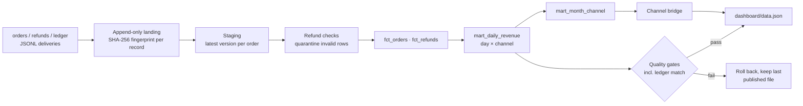

# Revenue Trust

Net revenue fell 12% from May to June. Before anyone acts on that, two things need to be true: the number has to be right, and someone has to know where the drop actually came from. This project does both: it builds revenue models from raw orders, refunds and a payment ledger, refuses to publish if the totals don't reconcile, and then breaks the June decline down by channel.

**Stack:** Python, SQL (SQLite), dbt + DuckDB, GitHub Actions
**Data:** a generated e-commerce scenario (seed 41, January–June 2025). The orders, refunds and ledger are simulated, so the figures describe the scenario, not a real company.
**Dashboard:** [project page](https://beyzamercanse.github.io/project1/work/revenue-trust.html) · or open `dashboard/index.html` locally

## Key numbers

| | |
|---|---:|
| Source events delivered | 15,248 |
| Unique source records after deduplication | 14,770 |
| Paid orders | 6,688 |
| Net revenue, Jan–Jun | £577,067.86 |
| Days reconciled to the ledger | 181 of 181, to the penny |
| Invalid refunds quarantined | 3 |
| June vs May net revenue | −£12,273.54 (−11.97%) |
| Share of the drop from Mobile | 92% |

## Architecture



## How it works

**Landing.** Every delivered record is fingerprinted (SHA-256 of its canonical JSON) and inserted with `ON CONFLICT DO NOTHING`, so a retried delivery can't be counted twice. If the same order ID and version arrive with different contents, the load stops. Two versions can't both be right, and I'd rather fail than pick one quietly.

**Staging.** Orders get revised, so `stg_orders` keeps only the latest version per order with a window function. Money is stored as integer pence throughout. Floats and reconciliation don't mix.

**Refund rules.** A refund is quarantined (kept with a reason, not deleted) if its order doesn't exist, isn't paid, the amount is zero or negative, it's dated before the sale, or it pushes total refunds above what was paid. Three refunds in the data fail these rules.

**Publication gates.** Seven checks run inside the same transaction as the load: primary keys, refund referential integrity, no negative paid amounts, daily ledger reconciliation, cohort bounds and mart-to-mart consistency. If any fails, the transaction rolls back and the previously published `data.json` stays as it was. One test appends an unbalanced ledger entry and checks exactly that.

**Explaining June.** The month-level bridge splits the change into order volume, average order value and refunds. That says *how* revenue fell but not *where*, so I added a channel bridge (below).

## The channel bridge

`scripts/bridge.py` splits each channel's May→June change into four parts:

- **calendar:** June has 30 days, May has 31. That alone costs revenue at May's daily rate.
- **volume:** paid orders above or below May's daily run-rate.
- **order value:** change in average paid order value.
- **refunds:** change in refund postings.

Everything is computed in integer pence and order value is taken as the residual, so each channel's parts add up exactly to its change and the channels add up to the total. If they don't, the bridge raises instead of publishing.

| Channel | Calendar | Volume | Order value | Refunds | Change |
|---|---:|---:|---:|---:|---:|
| Mobile | −£889.52 | −£7,145.62 | −£834.89 | −£2,398.54 | **−£11,268.57** |
| Web | −£1,711.80 | −£1,896.32 | +£723.91 | −£975.82 | **−£3,860.03** |
| Marketplace | −£806.86 | +£3,072.51 | +£674.19 | −£84.78 | **+£2,855.06** |
| **Total** | −£3,408.18 | −£5,969.43 | +£563.21 | −£3,459.14 | **−£12,273.54** |

Two things stand out. About £3.4k of the "decline" is just a shorter month. And Mobile is where the real problem is: fewer paid orders than its own run-rate, plus refunds that more than tripled. Marketplace grew and hides part of it in the total. This tells you where to look, not why it happened. That needs checkout and payment logs, which this dataset doesn't have.

## Run it

Python 3.9+, standard library only.

```sh
python3 scripts/pipeline.py               # generate fixtures, load, model, check, publish
python3 -m unittest discover -s tests -v  # 12 tests
python3 scripts/pipeline.py               # second run: new_events = 0, same output
python3 dashboard/refresh.py              # update the offline dashboard's data.js
```

The dbt port (`dbt/`) rebuilds the four core models in DuckDB with ten data tests. Setup is in [dbt/README.md](dbt/README.md).

## Tests worth reading

- rerunning is idempotent and produces a byte-identical `data.json`
- a late order revision updates history; an older version can't overwrite a newer one
- conflicting payloads for the same version are rejected
- malformed dates (`2025-02-30`) stop the load before anything is published
- an unbalanced ledger blocks publication and rolls back the load
- the channel bridge balances to the penny, including for a channel that didn't exist in the base month

## Repository layout

```text
scripts/generate_demo.py   seeded fixture: orders, refunds, ledger, deliberate faults
scripts/pipeline.py        landing, transforms, quality gates, export
scripts/bridge.py          channel revenue bridge in integer pence
sql/01_staging.sql         latest versions, refund quarantine, facts
sql/02_marts.sql           daily revenue, reconciliation, cohorts, month × channel
dbt/                       the same models in dbt + DuckDB
tests/                     pipeline and bridge tests
docs/                      architecture, metric definitions, case study
dashboard/                 static dashboard built from data.json
```

More detail: [architecture](docs/architecture.md) · [metric definitions](docs/metric-contracts.md) · [case study](docs/case-study.md)

## What I'd do with real data

Reconcile against a ledger that Finance owns, not one generated next to the orders. Join payment-attempt logs so mobile checkout failures can be measured against attempts rather than inferred from order counts. And move the marts to incremental, partitioned builds once volume justifies it. At 15k rows a full rebuild takes under two seconds, so I kept it simple.

MIT licensed.
