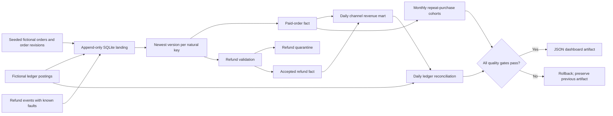
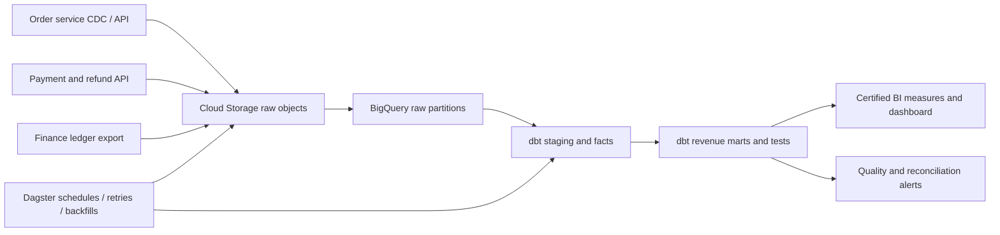

# Architecture and operating design

## Business contract

Finance and Growth need the same definition of net revenue. The output should answer where June's decline is concentrated and should refuse to publish unreconciled numbers. The reference implementation models merchandise sales and refunds in GBP, without VAT, shipping, cost of goods, exchange rates, accrual accounting, or payment processor fees.

## Implemented local architecture

| Layer | Grain / key | Responsibility |
|---|---|---|
| Raw orders | One distinct payload fingerprint; natural key `(order_id, version)` | Retain valid source versions, ignore exact redelivery, reject conflicting same-version payloads |
| Raw refunds | One distinct payload fingerprint; natural key `(refund_id, version)` | Same event history rules |
| Raw ledger | One immutable `entry_id` | Accept append-only postings; corrections require new adjusting entries |
| `stg_orders` | One `order_id` | Window function selects highest source version regardless of delivery order |
| `fct_orders` | One paid `order_id` | Defines paid merchandise amount in integer pence |
| `fct_refunds` | One valid `refund_id` | Preserves event posting date and order dimensions |
| `refund_quarantine` | One rejected `refund_id` | Explains invalid records and retains enough information for triage |
| `mart_daily_revenue` | One `(day, channel)` | Certified additive financial measures |
| `mart_reconciliation` | One day | Full date coverage, with zero as the missing-side amount |
| `mart_cohorts` | One `(cohort month, activity month)` | First-paid-purchase cohort; distinct repeat customers |
| `mart_month_channel` | One `(month, channel)` | Input to the channel bridge; must sum to `mart_daily_revenue` (publication gate) |

## Failure handling

- Unexpected fields, invalid types, non-canonical dates, negative order amounts, and source-version collisions fail the load.
- Exact duplicates are ignored by fingerprint, without suppressing distinct later revisions.
- Refunds without a paid order, refunds before the sale, nonpositive amounts, and per-order excess refunds are quarantined.
- If otherwise-valid refunds collectively exceed a payment, **all** otherwise-valid refunds for that order are quarantined. This favors an explicit unresolved state over arbitrary event selection.
- Daily reconciliation discrepancies block the transaction. The previous database state and dashboard remain available.
- A late refund whose order has not yet arrived can move out of quarantine after the order arrives, because staging and marts are rebuilt from source history on every successful run.
- A failed-run alert and durable run audit store are production requirements, not implemented services. The command exits nonzero; CI captures its log.

## Incremental semantics and tradeoff

Landing is incremental: only unseen event payloads are inserted. Marts are rebuilt transactionally, which is appropriate for this small fixture and makes late corrections safe. At warehouse scale, maintain a changed-order set and rebuild all affected original-sale and refund-date partitions, then reconcile those partitions before promoting a new dashboard snapshot. A simple three-day lookback would silently miss older corrections and is deliberately not represented as sufficient.

## Proposed production architecture — not deployed

Choose BigQuery only when that matches target employers; DuckDB, Snowflake, or a Microsoft stack can serve the same modeling contract. The engineering evidence is the contract and operating behavior, not a list of vendors.

Production acceptance criteria: replay any historical partition with identical results; reconcile to the approved ledger tolerance; detect missing sources before publication; preserve source version and load provenance; restrict raw customer identifiers; retain an incident runbook; establish a cost cap and record scanned bytes. Targets such as “daily by 07:00 UTC” are design requirements to agree with a real stakeholder, not achieved uptime claims.

## Ownership and security design

Finance owns the approved revenue definition and reconciliation policy. Data Engineering owns ingestion and backfills. Analytics Engineering owns modeled facts, tests, documentation, and BI contract. Analysts own interpretation and decision recommendations. The demo has fictional customer IDs and no secrets or personal data. A production version would use service-account permissions, secret management, least-privilege BI views, and agreed retention rules.
